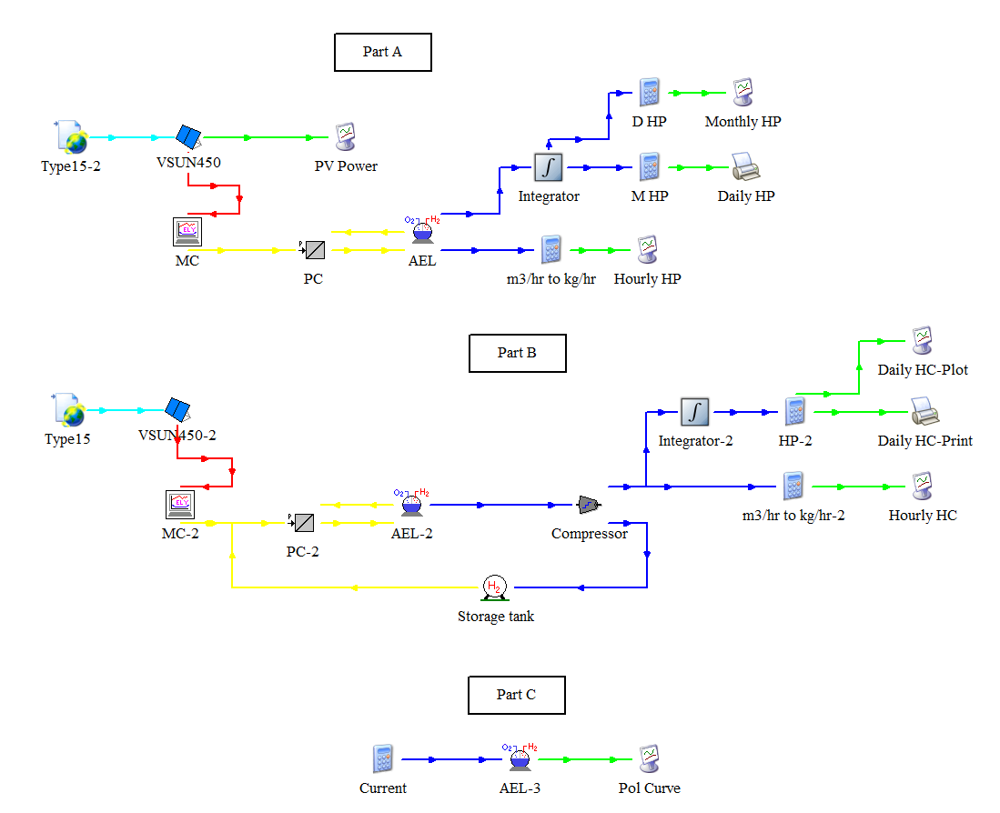

# Solar Hydrogen Production and Storage in TRNSYS

A renewable energy coursework project by **Pouya Asghari**, modeling a photovoltaic array, alkaline electrolyzer, compressor, and hydrogen storage tank under Phoenix, Arizona weather conditions.



## Objective

Size a PV-powered hydrogen system for approximately 5 kg/day average hydrogen production, examine annual operation, and investigate compression to 200 bar, storage control, and electrolyzer polarization.

## System and methods

- VSUN450-144BMH PV module specifications used in a TRNSYS Type 103 model.
- Alkaline electrolyzer, power conditioning, controller, compressor, and compressed-gas storage components.
- Annual simulation period of 8760 hours using Phoenix TMY2 weather inputs.
- Final reported array configuration: 30 modules in series and seven parallel strings, totaling 210 modules (94.5 kWp at 450 W/module).
- Production indicators, storage-related outputs, and a separate polarization-curve branch.

## Reported results and review status

| Quantity | Value | Interpretation |
| --- | ---: | --- |
| Target average hydrogen production | 5 kg/day | Design target |
| Saved final production indicator | 4.9164 | Report interprets this as kg/day; conversion basis needs checking |
| Saved post-compression indicator | 126.8602 | Not validated as a physical mass flow |
| Compressor discharge setting | 200 bar | Source model setting |
| Storage maximum pressure | 350 bar | Source model setting |
| Storage tank volume | 370 m³ | Verify intended design scale |

**Compression does not increase hydrogen mass production.** The source applies different density factors before and after compression; the volumetric flow reference conditions must be verified against the TRNSYS component documentation. The apparent large post-compression increase is not claimed here as a physical result.

The report also divides cumulative integrated production by 365 or 12. Only the final values are annual-average daily or monthly indicators; these are not independent daily or calendar-month totals. The 70–90% storage control band corresponds to 245–315 bar, above the stated compressor discharge setting. See the editorial appendix in the report for these and other parameter checks.

## Repository contents

| Path | Contents |
| --- | --- |
| [report/main.pdf](report/main.pdf) | Typeset English report with separate editorial review |
| [report/main.tex](report/main.tex) | Editable LaTeX source |
| `report/figures/` | Original report images |
| [report/BUILD.md](report/BUILD.md) | LaTeX and Overleaf instructions |
| [trnsys/HW2.tpf](trnsys/HW2.tpf) | Original Simulation Studio project |
| [trnsys/HW2.dck](trnsys/HW2.dck) | Original TRNSYS input deck and embedded equations |
| `trnsys/HW2.PTI` | Original associated parameter file |
| `trnsys/HW2.log`, `trnsys/HW2.lst` | Archived simulation log and listing |
| `trnsys/AEL_Daily_HP.out`, `trnsys/HC_daily.out` | Original saved output tables |
| [docs/RUNNING.md](docs/RUNNING.md) | Dependencies and reproduction workflow |
| [code/README.md](code/README.md) | Instructions for adding separately stored code |

## Requirements and reproduction

Use a compatible TRNSYS installation with the component implementations referenced by the deck, including Types 15, 103, 160, 100, 175, 167, 164, 24, 25, and 65. The original paths reference a TRNSYS18 installation. Exact installed component-library versions were not supplied.

The Phoenix TMY2 weather file and `Type160-Electrolyzer.dat` are external dependencies referenced by absolute Windows paths and are not included in the archive. Obtain compatible data and component files, update the paths in a working copy, and review the parameter and unit issues before running. The simulation has not been rerun during repository preparation.

The native model and outputs are preserved unchanged. Separately stored scripts can be added under `code/`, with their actual dependencies and verified run commands. No missing scripts have been reconstructed.

## Build the report

Upload the complete ZIP to Overleaf, select `report/main.tex`, and use pdfLaTeX. Or run from the repository root:

```bash
cd report
pdflatex -interaction=nonstopmode -halt-on-error main.tex
pdflatex -interaction=nonstopmode -halt-on-error main.tex
```

No custom fonts or bibliography files are required. Only the LaTeX source and its figure folder are needed for compilation.

## Academic context

Renewable Energies course, School of Mechanical Engineering, College of Engineering, University of Tehran. Adviser: Dr. Pouria Ahmadi. Original report date: 1404.09.06 (Iranian calendar).

The supplied report was already in English. LaTeX conversion, repository documentation, and the separate editorial review were prepared with AI assistance. Original simulation files and figures are retained. Numerical claims in the historical report have not been independently validated.

## License

No license has been selected. Add one when the intended reuse permissions have been decided. Referenced software, weather data, and third-party materials retain their own terms.
